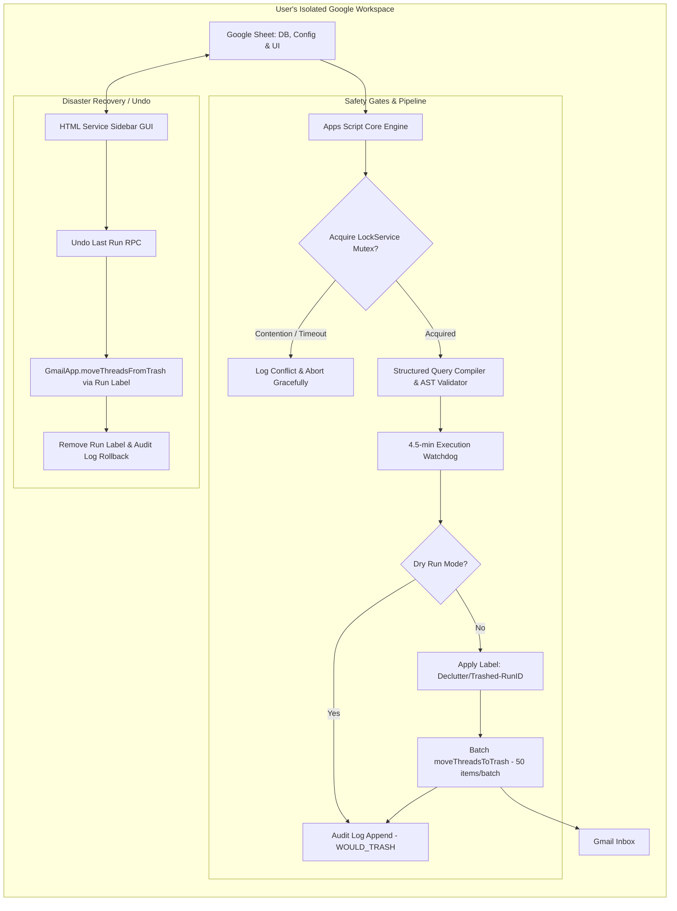

# Declutter: Production Implementation Plan & Technical Spec (Hardened)

## 1. System Architecture & Threat Model

Declutter runs as a **decentralized, container-bound Google Apps Script application** anchored inside a Google Sheet.

### Architectural Rationale & Threat Mitigations:
- **Zero Token Custody:** No centralized database holds user OAuth refresh tokens. In the event of an external security breach, zero third-party inboxes are compromised.
- **Bypasses CASA / Google Verification Wall:** Executing within the user's private Google Workspace tenant eliminates mandatory CASA Tier 2/3 security audits ($15k–$75k) for the restricted `gmail.modify` scope.
- **Atomic Quota & Tenant Isolation:** Execution limits and Gmail API quotas are isolated per user rather than pooled against a centralized cloud project billing account.
- **Concurrency & Race Condition Guard:** Hardened with Apps Script `LockService` mutex locks to prevent simultaneous manual and automated trigger collisions.
- **Two-Way Safety & Reversibility:** Trashed emails are tagged with a unique run label (`Declutter/Trashed-<RunID>`) and tracked by thread ID, enabling deterministic, 1-click recovery.



---

## 2. Phase-by-Phase Hardened Blueprint

### Phase 1: Environment, Manifest Hardening & Sheet Schemas
**Objective:** Enforce least-privilege scoping and define relational spreadsheet schemas with strict data validation.

1. **Explicit Manifest Configuration (`appsscript.json`):**
   - Strictly declare required OAuth scopes. Disallow generic Google Suite scopes.
   ```json
   {
     "timeZone": "Etc/UTC",
     "dependencies": {},
     "exceptionLogging": "STACKDRIVER",
     "runtimeVersion": "V8",
     "oauthScopes": [
       "https://www.googleapis.com/auth/gmail.modify",
       "https://www.googleapis.com/auth/spreadsheets",
       "https://www.googleapis.com/auth/script.scriptapp"
     ]
   }
   ```

2. **Sheet Template Architecture:**
   - **Tab 1: `Rules`**
     - Schema: `RuleID` | `SenderPattern` | `Keywords` | `RetentionDays` | `ProtectStarred` | `DryRun` | `Status`
     - Data Validation Rules:
       - `RuleID`: String, Unique UUID / monotonic slug.
       - `SenderPattern`: String (valid RFC 5322 email or `@domain.tld` wildcard).
       - `Keywords`: String (comma-delimited or quoted phrases).
       - `RetentionDays`: Integer $\ge 1$.
       - `ProtectStarred`, `DryRun`: Boolean (`TRUE`/`FALSE`).
       - `Status`: Dropdown list (`ACTIVE`, `PAUSED`).
   - **Tab 2: `Logs`**
     - Schema: `Timestamp` | `RunID` | `RuleID` | `Sender` | `Subject` | `ReceivedDate` | `ThreadID` | `Mode` | `Action`
     - Constraints: Freeze header row; format `Timestamp` and `ReceivedDate` as ISO-8601 timestamps; column `ThreadID` hidden or monospaced for audit tracing.
   - **Tab 3: `QuickStart`**
     - Visual onboarding reference: Explains how container scripts work, provides authorization screenshots, and explains how to bypass Google's "Unverified App" prompt.

---

### Phase 2: Concurrency Locking & Structured Query Compiler
**Objective:** Prevent race conditions and deliver an injection-proof query compiler that supports quoted phrases while neutralizing query breakouts.

1. **Concurrency Lock Service (`LockService`):**
   - Execute `LockService.getUserLock().tryLock(10000)` before any engine operation.
   - If lock acquisition fails after 10 seconds, write a warning log and terminate execution immediately to prevent parallel execution conflicts.

2. **Structured Query Compiler (`QueryCompiler`):**
   - Avoid naive string concatenation. Parse inputs through a tokenized sanitization pipeline:
     - **Sender Validation:** Ensure `SenderPattern` conforms strictly to an email (`user@domain.com`), domain prefix (`@domain.com`), or wildcard domain. Strip any whitespace, colons, or parentheses.
     - **Keyword Escaping & Phrase Preservation:**
       - Support exact phrase search (e.g. `"verification code"`).
       - Strip dangerous query control characters (`\r`, `\n`, `{`, `}`, `(`, `)`).
       - Neutralize unescaped colons `:` to prevent Gmail operator injection (e.g., `to:`, `label:`, `category:`).
       - Disallow standalone Boolean operators (`OR`, `AND`, `NOT`) from leaking outside quoted phrases.
     - **Mandatory System Enforcements:**
       - Append `older_than:<RetentionDays>d`.
       - Append `-is:starred` (if `ProtectStarred == TRUE`).
       - Append `-in:trash -in:spam -label:Declutter-Exempt`.
     - **Compiled Output Template:**
       ```
       (from:<sanitized_sender>) AND (<sanitized_keyword_clause>) older_than:<N>d -in:trash -in:spam -label:Declutter-Exempt -is:starred
       ```

3. **Execution Watchdog & Pagination Budgeting:**
   - Soft ceiling: **4.5 minutes (270,000 ms)**.
   - Loop chunks of at most 100 threads per `GmailApp.search(compiledQuery, 0, 100)`.
   - Before fetching or processing the next batch, evaluate:
     ```typescript
     if (Date.now() - startTime > 270000) {
       logInfo("Watchdog threshold reached. Flushing state and deferring remainder to next trigger cycle.");
       break;
     }
     ```

---

### Phase 3: Rollback Engine & Two-Way Safety Pipeline
**Objective:** Eliminate the risk of catastrophic data loss by supporting atomic run labeling and instant rollback.

1. **Run Identification & Tagging:**
   - Generate a monotonic `RunID` per execution (e.g., `RUN-20261010-080000`).
   - Create or fetch a dedicated Gmail Label: `Declutter/Trashed-<RunID>`.
   - In production mode (`DryRun == FALSE`), apply the run label to matched threads **before** moving them to trash via `GmailApp.moveThreadsToTrash(threads)`.

2. **Rollback Mechanism (`undoLastRun`):**
   - Query recent entries from `Logs` or read the latest `Declutter/Trashed-*` label.
   - Search Gmail: `in:trash label:Declutter/Trashed-<RunID>`.
   - Restore threads back to the inbox via `GmailApp.moveThreadsFromTrash(threads)`.
   - Strip the run label and record a `RESTORED` event in the `Logs` sheet.

---

### Phase 4: Observability, High-Performance I/O & Log Hygiene
**Objective:** Maintain high throughput, prevent Apps Script service throttling, and avoid spreadsheet recalculation bottlenecks.

1. **Batch Memory Buffering:**
   - Never call `sheet.appendRow()` inside processing loops.
   - Accumulate log records into an in-memory buffer (`logBuffer: any[][]`).
   - Flush `logBuffer` to the `Logs` sheet using a single `range.setValues()` call inside a `finally` block.

2. **Threshold Log Rotation (Performance-Optimized):**
   - High row counts degrade Google Sheets performance, and per-run row deletions are excessively slow.
   - **Rotation Policy:**
     - Check total rows only upon engine completion.
     - Prune only when total rows exceed **6,000**.
     - Delete the oldest 1,000 rows in a single batch operation (`sheet.deleteRows(2, 1000)`), keeping active log volume stabilized around 5,000.

---

### Phase 5: Responsive GUI & Non-Developer Control Panel
**Objective:** Provide an intuitive interface that completely abstracts raw sheet manipulation.

1. **Container Menu Integration (`onOpen`):**
   - `Declutter > Control Panel` (Launches HTML sidebar)
   - `Declutter > Run Declutter (Manual)`
   - `Declutter > Undo Last Run` (Rollback dialog)
   - `Declutter > Setup / Reset Daily Automation`

2. **Lightweight Sidebar (`Sidebar.html`):**
   - Built with PicoCSS for responsive, zero-build UI.
   - Controls:
     - Rule creator (Sender, Keywords, Retention Slider, Dry-Run toggle).
     - Execution status indicator with real-time log stream.
     - "Undo Last Run" button with run metadata (timestamp, affected thread count).
   - RPC Boundary: Wrap `google.script.run` calls in comprehensive error handlers displaying human-readable alert banners.

---

### Phase 6: Frictionless Distribution & Self-Onboarding
**Objective:** Enable non-technical users to clone and run the tool in under 60 seconds with clear authorization guidance.

1. **Direct Copy Link:**
   - Link format: `https://docs.google.com/spreadsheets/d/{SPREADSHEET_ID}/copy`.
2. **Automated Trigger Registration:**
   - Bound triggers do not copy automatically. The user runs `Declutter > Setup / Reset Daily Automation`.
   - Code programmatically creates a daily 2:00 AM clock trigger:
     ```javascript
     ScriptApp.newTrigger('runDeclutterEngine')
       .timeBased()
       .everyDays(1)
       .atHour(2)
       .create();
     ```
3. **Authorization Onboarding UX:**
   - The embedded `QuickStart` sheet tab explains:
     1. Why the Google authorization modal appears (container-bound script access).
     2. Step-by-step clicks: **Advanced** $\to$ **Go to Declutter (unsafe)** $\to$ **Allow**.
     3. Assurance that all data remains 100% within their own Google account.

---

## 3. Comprehensive Verification & Edge Case Test Matrix

| Test ID | Scenario / Edge Case | Expected System Behavior | Production Safeguard |
|---|---|---|---|
| **TC-01** | Matching thread is starred | Skipped from matching | Mandatory `-is:starred` clause |
| **TC-02** | Matching thread has manual override label | Skipped from matching | Mandatory `-label:Declutter-Exempt` clause |
| **TC-03** | Malformed input (blank sender, negative retention) | Rule skipped, error logged to audit table | Row validator before query compilation |
| **TC-04** | Execution hits 4.5 minutes during large inbox run | Engine flushes buffered logs and terminates cleanly | Watchdog circuit breaker (`Date.now() - start > 270000`) |
| **TC-05** | Malicious / operator injection in keywords (e.g. `) OR (from:*`) | Control characters and operators neutralized, query grouped | Structured query compiler escaping tokens |
| **TC-06** | Large backlog (>1,500 matching threads) | Chunked retrieval (100/batch) and batched trashing (50/batch) | Chunker loop with watchdog check |
| **TC-07** | Dry-Run enabled on rule | Audit log records `WOULD_TRASH`; zero inbox modifications | Conditional mutation block |
| **TC-08** | Concurrent runs (Trigger fires during manual sidebar run) | Second process fails lock acquisition and logs contention | `LockService.getUserLock().tryLock(10000)` |
| **TC-09** | Accidental mass-trashing requires restoration | User executes "Undo Last Run"; all threads restored to Inbox | Labeling with `Declutter/Trashed-<RunID>` + `moveThreadsFromTrash` |
| **TC-10** | High log volume exceeds 6,000 rows | Oldest 1,000 rows purged in a single atomic deletion | Threshold-based log rotation policy |
| **TC-11** | User copies template sheet to new Google account | Custom menu initializes; trigger created via Setup command | Programmatic trigger registration with QuickStart guide |

---

## 4. Production Safeguards Added
- **Query Injection Firewall:** Tokenized query compiler preventing boolean breakout, operator injection, and parenthetical corruption while preserving phrase quotes.
- **Atomic Concurrency Mutex:** `LockService` prevents parallel race conditions between scheduled cron triggers and user UI clicks.
- **Deterministic 1-Click Rollback:** Session-tagged Gmail labels (`Declutter/Trashed-<RunID>`) and logged thread IDs enable programmatic inbox restoration.
- **Execution Watchdog & Safe Chunker:** 270-second ceiling prevents silent Apps Script timeout termination and partial state corruption.
- **High-Performance Log Rotation:** Shifted from slow per-run deletions to threshold-based 1,000-row batch rotation at 6,000 rows.
- **Zero-Friction Consent Guide:** Embedded `QuickStart` sheet tab eliminating drop-off at the unverified app warning.
