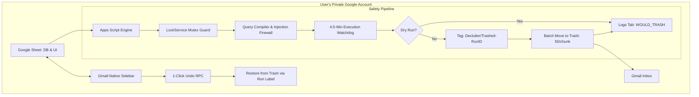

# Declutter

> **Zero-Token-Custody, Decentralized Gmail Inbox Cleaner anchored in Google Sheets with Deterministic Retention Rules & 1-Click Disaster Recovery.**

---

## 🔒 Why Declutter? The Zero-Custody Threat Model

Most commercial email cleanup services operate as centralized SaaS platforms. To clean your inbox, they require you to grant them OAuth access, storing your **OAuth refresh tokens on a central cloud database**.

If that centralized startup is breached, thousands of user inboxes are compromised. Furthermore, to access restricted Gmail scopes (`gmail.modify`) without warnings, Google forces commercial SaaS companies to pay **\$15,000 to \$75,000 USD annually** for third-party CASA security audits—costs that get passed down to users via recurring subscriptions.

**Declutter flips this architecture entirely:**

* **Zero Token Custody:** Runs as a **container-bound Google Apps Script** inside your own Google Sheet. No external server, database, or API key ever touches your emails or tokens.
* **100% Private & Free Forever:** Code executes entirely inside Google's private cloud runtime in your own tenant.
* **Two-Way Safety & Reversibility:** Trashed emails are tagged with an ephemeral session label (`Declutter/Trashed-<RunID>`) and tracked by thread ID in an immutable Sheet audit log. If a rule mistakenly trashes an email, click **"Undo Last Run"** to restore every thread back to your Inbox in seconds.



---

## 🚀 QuickStart & 1-Click Setup

### For Non-Developers (60-Second Setup):
1. **Clone the Master Sheet:** Open the 1-Click Clone link:  
   `https://docs.google.com/spreadsheets/d/1X0u6iFTzWtK58vkWq4c3UGVNRRZ-6AFyn7JhTuk3lgM/copy`
2. Click the blue **"Make a copy"** button. The sheet and its private script are copied directly to your personal Google Drive.
3. In your cloned sheet, click **Declutter > Setup / Reset Daily Automation**.
4. **Complete the 1-Time Authorization:**
   * When Google shows *"Authorization Required"*, click **Continue**.
   * On the *"Google hasn't verified this app"* screen, click **Advanced** *(bottom-left link)* $\to$ click **Go to Declutter Master Template (unsafe)** $\to$ click **Allow**.
   * *(See below for why Google shows this prompt).*
5. Open **Declutter > Control Panel** anytime to add retention rules, test with Dry-Run, or run manual cleanups!

---

## 🛡️ Why Does Google Show "Google hasn't verified this app"?

When authorizing Declutter for the first time, Google displays an unverified app prompt. **This is proof of your privacy:**

1. **You are the developer:** Google clones the script directly into your personal Google account. It does not belong to a commercial third party.
2. **Avoiding Corporate Tolls:** Google charges companies \$15k–\$75k/year to remove this screen. Because Declutter is an open-source, private utility designed for individuals, we do not funnel your money into corporate compliance fees.
3. **Auditability:** Unlike black-box SaaS tools, you can open **Extensions > Apps Script** in your sheet and inspect every single line of code running on your data.

---

## 🛠️ Production Safeguards

* **Query Injection Firewall:** Tokenized query compiler in [QueryCompiler.js](file:///c:/Users/HP/de-clutter/QueryCompiler.js) preserving exact phrases (e.g., `"verification code"`) while neutralizing operator injection (`OR`, colons `:`, unbalanced parentheses).
* **Deterministic 1-Click Rollback:** [RollbackManager.js](file:///c:/Users/HP/de-clutter/RollbackManager.js) tracks `Declutter/Trashed-<RunID>` labels and thread IDs, restoring threads via `GmailApp.moveThreadsFromTrash()` in atomic 50-thread batches.
* **Concurrency Mutex:** [LockManager.js](file:///c:/Users/HP/de-clutter/LockManager.js) uses `LockService.getUserLock()` with a 10-second timeout to prevent race conditions between scheduled cron triggers and manual sidebar runs.
* **Execution Watchdog & Pagination:** [ExecutionEngine.js](file:///c:/Users/HP/de-clutter/ExecutionEngine.js) imposes a 4.5-minute ceiling with 100-thread chunking, preventing silent Apps Script timeouts.
* **Threshold Log Hygiene:** [SheetStore.js](file:///c:/Users/HP/de-clutter/SheetStore.js) uses single-call `setValues()` batch flushes and automatically prunes 1,000 oldest rows when total logs exceed 6,000.
* **Gmail-Native Interface:** [Sidebar.html](file:///c:/Users/HP/de-clutter/Sidebar.html) features auto Dark/Light theming matching the user's system theme (`prefers-color-scheme`) and promise-wrapped RPC calls.

---

## 💻 Developer Setup (CLI Deployment via `clasp`)

If you want to modify the source code locally and push directly to your Google Sheet:

```bash
# 1. Enable Google Apps Script API at https://script.google.com/home/usersettings
# 2. Login to Google via CLI
npx @google/clasp login

# 3. Push code to your Google Sheet
npx @google/clasp push
```

---

## 📄 License
MIT License. Open-source, zero-custody, private by design.
